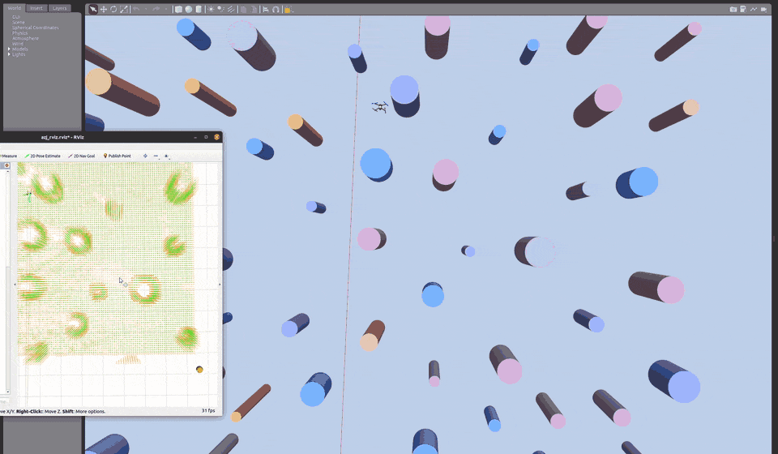
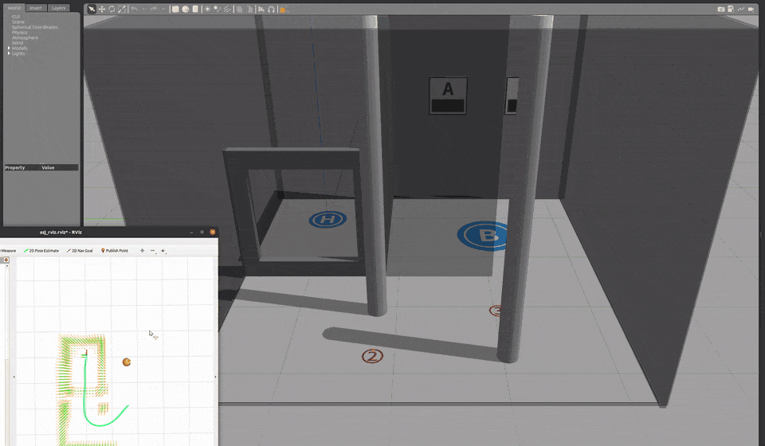
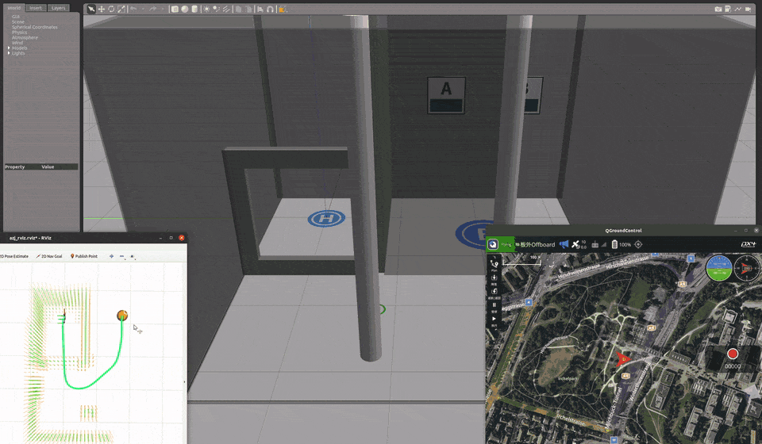

# Azj Planner

安全优先的 3D 局部规划器。**不追求路径最短 / 最快，追求与障碍的最大距离。**



密集柱阵（90 根柱，最近缝净宽 1.20 m）穿行，限速 1 m/s。
路径主动走柱间**正中**，不贴任何一侧 —— 既不切角也不贴柱，转弯处也保持平滑。

| 室内迷宫 · 门框与立柱 | 室内迷宫 · 墙角绕行 |
|:---:|:---:|
|  |  |

<sub>绿色 = 规划路径，橙点 = rviz 打点目标，左下角是俯视 ESDF（黄绿 = 膨胀障碍）。
上方柱阵为 6 倍速，两个室内场景为 2 倍速。均在 PX4 SITL + Gazebo 中实跑。</sub>

---

## 0. 关于名字

`Azj` 是三个人名字的首字母 —— **As**（我）、**Zjr**、**Jg**。

这个规划器的命名，是为了我们三人在大学飞创实验室留下来的坚实友情所定。
我们从大一开始钻研 UAV，从一开始的小白，到团结拿下比赛冠亚 ——
留下来的不止是荣誉，还有友情中的默契。

这段日子会过去，但永远不会被遗忘。

名字就这么定下来了，不为别的，为了记住那段友情。

- **jg** — [@lxy3178066206](https://github.com/lxy3178066206)
- **zjr** — 在 [as_controller](https://github.com/SpadeA666/as_controller) 里的提交身份是 `zjrwxl`

---

## 1. 设计理念

EGO 和 SUPER 的目标函数里，`clearance` 是一个**阈值**：

```cpp
// EGO: bspline_opt/src/bspline_optimizer.cpp, calcDistanceCostRebound
double dist_err = cps_.clearance - dist;
if (dist_err < 0) {
  /* do nothing */        // ← dist > clearance 时，代价 0、梯度 0
}
```

SUPER 走另一条路：从障碍扩张出多面体，轨迹只要在凸多面体内部，**往左往右完全等价**，没有任何居中项。

两者共同的结果：**可行域内无差别 → 解由最短路径或初值决定 → 必然贴边。**

这不是调参能解决的问题，是目标函数的形式问题。

Azj 把 clearance 当**连续收益**：

```
edge_cost = len * (1 + w * (clearance_ref / clamp(c, ·, clearance_cap))^alpha)
```

- `len` 仍是主目标 → 不会为了更宽而绕远路
- `w * (ref/c)^alpha` 是有界修正项 → 任何 clearance 下都留有梯度，把路径往通道中轴推
- `w = 0` 时精确退化成纯最短路径（也就是 EGO 的贴边行为）——所以 `w` 的效果可以直接对照

**架构上的关键决定**：建图完全复用 [ROG-Map](https://github.com/hku-mars/ROG-Map) 的 ESDF，
不修改其任何源码，只在 CMake 里 `find_package(rog_map)` 链接它的静态库。
`rog_map` 已提供 `getDistance` / `evaluateEDT` / `evaluateFirstGrad` / `evaluateSecondGrad`，
是一套完整的 clearance 标量场 + 梯度场。

---

## 2. 包结构

```
azj_planner/
├── include/azj_planner/
│   ├── clearance_field.h     # clearance 场抽象（不依赖 ROS，可离线单测）
│   ├── path_search.h         # A* + 简化/平滑接口
│   ├── trajectory.h          # 时间参数化（路径 → p/v/a 对时间）
│   ├── curve_optimizer.h     # 折线 → C2 连续 B 样条（ESDF 梯度优化）
│   ├── minco.h               # MINCO s=4 参数化（移植，见文件头许可）
│   └── minco_optimizer.h     # MINCO 优化器（ESDF 代价 + 时间联合优化）
├── src/
│   ├── path_search.cpp       # 核心搜索算法
│   ├── trajectory.cpp        # 沿弧长的速度规划（TOPP 简化版）
│   ├── curve_optimizer.cpp   # B 样条求值 + 曲线优化（含线搜索）
│   ├── minco.cpp             # MINCO 线性系统 + 梯度回传
│   ├── minco_optimizer.cpp   # 居中/安全/动力学代价
│   └── azj_planner_node.cpp  # ROS 节点，继承 rog_map::ROGMapROS
├── test/
│   ├── offline_clearance_test.cpp   # 居中性质验证（含 ASCII 俯视图）
│   ├── trajectory_test.cpp          # 速度曲线验证
│   ├── curve_optimizer_test.cpp     # 曲线 + 两侧等距验证
│   ├── minco_test.cpp               # MINCO 数学正确性（梯度 vs 数值差分）
│   ├── minco_optimizer_test.cpp     # MINCO 优化器行为（居中/安全/不减速）
│   └── e2e_publish_test.py          # 闭环端到端验证（含安全静默）
├── config/azj_planner.yaml
├── launch/azj_planner.launch
├── rviz/azj_sim.rviz         # 仿真用（含 2D Nav Goal 打点）
└── ../sh/raicom_azj.sh       # 一键仿真脚本（在 catkin_ws/sh/ 下）
```

**注意包名**：`azj_planner`，不是 `Azj-planner`。catkin 要求包名匹配 `^[a-z][a-z0-9_]*$`，
大写字母和连字符都会被直接拒绝。

---

## 2.5 轨迹后端：MINCO（默认）

规划分三层，每层职责不同：

```
A* (path_search)      → 折线 + 居中代价（clearance 当连续收益）
   ↓
MINCO (minco_optimizer) → 7 次多项式，形状与时间**联合**优化
   ↓
publishTick           → 50Hz 采样发布 pos_cmd
```

### 为什么从 B 样条换成 MINCO

B 样条（`curve_optimizer`）只约束起点的**速度**，不约束加速度。
而滚动重规划每 0.1s 就重建一次轨迹，于是每条新轨迹都从 `v0` 靠
`max_acc` 重新加速，**速度永远停在加速段**（实测 `|v0|` 恒 0.285，
而 `max_vel=1.0`）。

MINCO 的 `setConditions(headPVAJ, tailPVAJ, pieceNum)` 把起点
**p / v / a / j 全部硬约束**，段间 C3 连续 —— "接着飞"是结构性保证，
不依赖速度补偿。

### 起点的 a / j 从旧轨迹取，不是 odom 差分

这是 MINCO 相对 B 样条的全部价值所在：告诉优化器"我正以 a 加速"。
拿不到旧轨迹（新目标）时才置 0，那是"从静止起步"的正确语义。

### 后端可切换

```yaml
traj_backend: 1    # 1 = MINCO（默认）, 0 = B 样条 + TOPP（旧路径，保留可回退）
```

两个后端都保留，出问题改一个参数即可回退，不用改代码。

### 上游来源与许可

`minco.h` / `minco.cpp` 的算法与带状线性系统构造移植自
[SUPER](https://github.com/hku-mars/SUPER)（HKU MaRS Lab），
其 MINCO 实现又源自 Zhepei Wang 的 MIT 许可版本（ego-planner 同源）。
原许可与署名保留在 `minco.h` 文件头。

本包对上游代码的改动：去掉 ROS/SUPER 数据类型依赖，改为
`azj_planner` 命名空间，新增 `evaluatePVAJ()` 直接求值接口。

---

## 3. 构建与运行

```bash
cd ~/catkin_ws
catkin build azj_planner

# 离线验证（不需要 ROS、不需要地图、不需要 bag）
./devel/lib/azj_planner/offline_clearance_test   # 居中性质
./devel/lib/azj_planner/trajectory_test          # 速度曲线

# 闭环端到端（隔离 master，不影响正在跑的 11311）
ROS_MASTER_URI=http://127.0.0.1:11424 roscore -p 11424 &
rosrun azj_planner azj_planner_node _azj/unknown_as_free:=true \
    _azj/free_clearance_if_unknown:=1.2 &
python3 src/azj_planner/test/e2e_publish_test.py            # 可达：验证推进与 COMPLETED
python3 src/azj_planner/test/e2e_publish_test.py --expect-fail  # 不可达：必须 0 条

# 运行节点
roslaunch azj_planner azj_planner.launch

# 发目标点
rostopic pub /move_base_simple/goal geometry_msgs/PoseStamped \
  '{header: {frame_id: "map"}, pose: {position: {x: 8.0, y: -4.0, z: 1.0}, orientation: {w: 1.0}}}'
```

输出：

- `/azj/path` — `nav_msgs/Path`
- `/azj/path_marker` — RViz `LINE_STRIP`

**本节点只发布路径，不发送任何控制指令**，不涉及解锁 / 起飞。

---

## 3.5 仿真接入（raicom 场景 + navigationIsoRviz）

一键脚本：**`~/catkin_ws/sh/raicom_azj.sh`**

```bash
cd ~/catkin_ws
./sh/raicom_azj.sh                          # 全套（控制器会起飞）
LAUNCH_CONTROLLER=0 ./sh/raicom_azj.sh      # 只看地图/规划，不飞
```

### ⚠ 这个脚本会起飞

`asnav_3d_node` 的 `main()` 第一句就是 `takeoff()`。只在仿真、本人在场时执行。
想先不飞就用 `LAUNCH_CONTROLLER=0`。

### 与 `sh/raicom.sh` 的关键差别

**不启动 `mission_planner click_demo.launch`。**
那个 launch 实际拉起的是 `super_planner` 的 `fsm_node` —— 它会和 azj_planner
抢 `/planning/pos_cmd`。两个规划器同时发参考，控制器收到的是混合指令，必炸。

### 数据链路

```
PX4 SITL (raicom.launch, ns=iris_0, iris_mid360_400)
  ├─ /livox/lidar2  (CustomMsg)
  └─ /iris_0/mavros/local_position/odom
        │
super_data_fix (_use_ground_truth:=true)
  ├─ /super_cloud   (map 系点云)
  └─ /super_odom
        │
azj_planner (rog_map ESDF → A* → 时间参数化)
  └─ /planning/pos_cmd   (quadrotor_msgs/PositionCommand)
        │
asnav_3d  case 1: navigationIsoRviz(0)
  └─ /iris_0/mavros/setpoint_raw/local
```

rviz 打点 → `/move_base_simple/goal` → azj_planner → `/planning/pos_cmd`。
`navigationIsoRviz` **自己不发 goal**（`nav_rviz_mode_` 分支），正好不会和规划器打架。

### 两个仿真专属的坑（脚本已处理）

**① mavros 话题前缀。** `raicom.launch` 用 `<group ns="iris_0">`，所以话题是
`/iris_0/mavros/...`。而 `rog_map` 的 `odom_topic` 是它**自己从 yaml 读**的，
参数服务器覆盖不了。脚本用 `sed` 生成 `/tmp/azj_planner_sim.yaml` 换前缀，
并断言替换成功才继续（失败就退出，不带着错前缀跑到现场）。

**② rviz 2D Nav Goal 的 z≈0。** 它是往地面平面点击，直接当目标高度用会让
飞机降到地面。脚本传 `_azj/goal_z_override:=$FLY_HEIGHT`（从
`nav_params.yaml` 的 `fly_height` 读，不硬编码）。日志会打印
`goal z overridden: 0.00 -> 0.80`。

### raicom 场景

约 4m x 4m 房间：`x ∈ [-3.35, 0.65]`、`y ∈ [-3.25, 0.75]`，围墙高 3m。
内部有隔墙和门框立柱（间距 1.3m）——适合验证"从缝正中间过"。

`virtual_ceil_height: 3.5` 高于墙高 3m，ESDF 不会被错误裁剪。

### 首跑踩到的坑（按严重程度排序，都已修）

**★ ① `p_miss` 用了默认值 → 空闲格子反而在增加占据概率（最致命）**

这一条是"建图糊成一坨 + 打点不飞"的总根因。

`rog_map` 的 `raycasting` 一组参数如果不在 yaml 里给出，会走代码默认值，
其中 **`p_miss` 默认 0.7**，而占据概率是按 log-odds 更新的：

```
l_miss = log(p_miss / (1 - p_miss)) = log(0.7 / 0.3) = +0.847   ← 正数！
```

于是 raycast 穿过的"空闲"格子**不是在降低占据概率，而是在升高**。
整个空间只增不减，全被填成实心——任何位置 clearance 都只剩 0.03~0.09m。

启动日志里能一眼看出来（两者相同就说明错了）：

```
[ROG] l_hit: 0.847298
[ROG] l_miss: 0.847298     ← 和 l_hit 一样，错
```

修法：`raycasting` 整段照抄 SUPER 能跑通的配置，关键是 **`p_miss: 0.49`**：

```
[ROG] l_hit: 2.19722       ← log(0.9/0.1)
[ROG] l_miss: -0.0400053   ← 负数，方向正确
```

**别只抄一部分。** 我最初只加了 `ray_range`，漏了概率那一组，结果就是上面这个现象。

对照验证（同一段 10s 点云 bag，只改这一组参数）：

| | occ 点数 | 房间中央最近障碍 | 西北角最近障碍 |
|---|---|---|---|
| `p_miss=0.7`（错） | 2265 | 0.260 m ✗被填 | 0.166 m ✗被填 |
| `p_miss=0.49`（对） | 431 | 0.477 m ✔空旷 | 0.477 m ✔空旷 |

**② UNKNOWN 被当成障碍 → 一次都规划不出来**

症状：`plan failed: start is inside an obstacle (ESDF <= 0)`。
雷达装在机体上，看不到自己所在的那个体素 → 那里必然是 UNKNOWN。
早期 `clearanceAt` 对 UNKNOWN 直接 `return -1`，等于说飞机自己在障碍里。

**注意**：修正成 `min(ESDF, cap)` **还是不行**——空地图/未探测区 ESDF 返回 0，
取 min 之后仍然是 0（实测 `esdf=0.000 unknown=1 clearance_used=0.000`）。
最终改为 UNKNOWN 时**不看 ESDF**，直接返回 `unknown_clearance_cap`。

**③ 仿真必须用 gazebo 真值位姿**

`super_data_fix` 的 GT 模式变换点云用的是 `t = [lio.x, lio.y, mav.z]`，
默认 `lio_odom` 是 `/Odometry_highrate`（FAST-LIO）。仿真实测：

| 源 | 相对真值偏差 |
|---|---|
| `gazebo_truth` | 0（基准） |
| `LIO` | 0.089 m（z 偏 8.4cm） |
| `super_odom` | 0.033 m |
| `mavros` | 0.010 m |

LIO 在仿真里会漂。**所以 `_lio_odom` 必须传 `/gazebo_truth/odom`**，
同时 `rog_map` 的 `odom_topic` 也用同一个真值话题 —— 点云变换与建图位姿
完全同源、完全同步。脚本已处理并断言。

### rviz 里「糊成一坨」多半是显示问题

`/rog_map/inf_occ` 是**膨胀后**的障碍点云，点数约为原始的 **4 倍**
（实测 49613 vs 12180）。用 `Style: Boxes` + `Size 0.1` 显示，视觉上就是一团糊。

脚本默认用**你自己的** `spadea/rviz/super.rviz`（`RVIZ_CFG`）。
如果你想让显示更清楚，可以把 `Mapping` 组里的点云从 `/rog_map/inf_occ`
换成 `/rog_map/occ`（原始障碍），并设 `Style: Points`、`Size: 0.03`。
包里另有一份 `azj_planner/rviz/azj_sim.rviz` 就是这么配的，可作参考。

判断「真的糊了」还是「显示问题」，别看点数，看**房间内部是否干净**：

```bash
# 房间中部 (x,y,z) 附近应当几乎没点
rostopic echo -n1 /rog_map/occ
```

实测：房间中部、门框下方都是 0 点；墙体两帧之间只差 0.003m → **地图是清晰的**。

### ★ rviz 话题必须对齐（"勾选了却看不到"的根因）

`super.rviz` 是给 SUPER 的 `fsm_node` 用的，里面全是**私有命名空间**下的话题：

| super.rviz 里写的 | azj_planner 实际发布 |
|---|---|
| `/fsm_node/rog_map/inf_occ` | `/rog_map/inf_occ` |
| `/fsm_node/unknown` | `/rog_map/unk` |
| `/fsm_node/fsm/path` | `/azj/path` |
| `/fsm_node/visualization/exp_traj` | `/azj/path_marker` |
| `/fsm_node/visualization/goal` | `/azj/goal_marker` |

**名字对不上 → 勾选了也永远是空的。** azj_planner 是独立节点，没有 `fsm_node` 前缀。

脚本的做法：**源文件不动**，复制到 `/tmp/azj_rviz.rviz` 后替换话题名，
并断言 `/rog_map/inf_occ` 和 `/azj/path` 都在配置里，否则直接退出。

生成的副本还会：
- 加一项 **`ROG Occupied (raw)` → `/rog_map/occ`**（绿色细点）。
  原来的 `ROG Inflated` 是膨胀版，点数可达原始的十几倍（合成房间实测
  **40710 vs 2226，18 倍**），看起来就是"糊成一坨"。
- 膨胀版改成半透明橙（`Alpha 0.30`），既能核对膨胀范围又不挡视线。
- 关掉 SUPER 专有的 SFC / backup_traj 显示项（azj 没有对应数据）。

### 路径/目标 marker 已加 latch

`/azj/path` 和 `/azj/path_marker` 用 `latch=true` 发布。
否则 rviz 晚于规划器启动时，订阅建立之前发的那一次会丢，
表现同样是"路径没有可视化"。

### ★ yaw 绝不能阶跃（"打点后直接旋转降落"的根因）

症状：打点后飞机猛地转 180° 然后掉下来。`rc/out` 出现
`[1000, 1648, 1035, 2000]` 这种最低油门与满油门并存的极端组合。

根因：早期 `computeYaw` 写的是

```cpp
last_yaw_ = std::atan2(v.y(), v.x());   // 直接赋值 = 阶跃
```

目标在飞机身后时 yaw 从 0 瞬间跳到 ±π。`navigationIsoRviz(0)` 是
`NAV_FULL`（`use_yaw=true`），会把这个 yaw 直接给 PX4，PX4 以最大角速率急转
→ 姿态/高度失控 → 掉落。

**SUPER 那边本来就有 `yaw_dot_max: 1.5`，你 2026-08-03 自己也调过这个值。
我做的时候漏了。**

现在的策略（`computeYaw`，2026-11-25 简化为两个模式）：

1. `goal_yaw` 给了固定值 → 用固定值（同样受速率限制）
2. **`yaw_mode: 0`（默认）→ 飞行中跟**路径几何切线**（当前参考点→前方 0.5m）；
   到点后自动朝打点/消息给的 yaw**
3. `yaw_mode: 1` → 全程保持机头，每帧发当前 yaw（控制器看不到变化）

> ⚠ 不要用「预规划 yaw 曲线按时间索引」（`yaw_prof->at(traj_t)`）。
> rolling 每 0.1s 重建轨迹且 `start = now`，`traj_t` 永远停在 0~0.14s，
> 永远读到**第一个 waypoint**（≈起始机头 0°）→ yaw 根本没跟随路径。
> 时间索引只在「一条轨迹飞到底」时成立（SUPER 是这样），滚动重建下结构性失效。

实测（目标在正后方 -X，2026-11-25 bench narrow 场景含 42° 转弯）：

| 设置 | yaw 范围 | 跨度 |
|---|---|---|
| `yaw_mode: 0` | 0.3° ~ 27.5° | 27.2°（跟随切线） |
| `yaw_mode: 1` | 0.000° ~ 0.000° | 0.0°（完全不转） |

### 日志必须行缓冲

`ROS_INFO` 走 stdout，重定向到文件时默认块缓冲，要攒几 KB 才 flush。
现场 `grep` 不到 `goal received` / `start diag` —— 这一轮排查在这上面浪费了三次。
脚本已改为：

```bash
stdbuf -oL -eL rosrun azj_planner azj_planner_node ... > /tmp/azj_planner.log 2>&1
stdbuf -oL -eL roslaunch as_controller asnav_3d.launch > /tmp/asnav_3d.log 2>&1
```

### 速度从 odom 的 twist 取

`vel_topic` 默认留空 = 用**建图那个 odom 话题**的 `twist.linear`。
理由：`/gazebo_truth/odom` 自带真值速度，mavros odom 也自带速度；
这样位姿与速度严格同源，也不必为仿真/真机分别配话题前缀。

### 注意：navigationIsoRviz 永不返回

`navigationRvizCore` 是 `while(ros::ok())` 死循环，**永远返回 false**
（`api_3d.cpp:1103`）。所以 `competition_3d.cpp` 的 `case 1` 不会跳到
`case 14`（自动降落）。仿真里要停就 Ctrl+C，或者自己加超时退出。

## 3.6 层高约束（★ 路径从地板下/天花板上绕的根因）

### 三个最容易混淆的概念

| 参数 | 作用 | 管不管规划 |
|---|---|---|
| `rog_map/virtual_ground_height`<br>`rog_map/virtual_ceil_height` | **点云裁剪边界**：决定哪些点进地图 | **不管** |
| `rog_map/inflation_step` | 膨胀步数，**同时会双向侵蚀上面两个边界** | 间接 |
| `azj/floor_z` / `azj/ceil_z` | **规划可通行空间** | **管** |

**改 `virtual_*` 不会改变路径高度** —— 它只决定点云进不进地图。
真正约束规划的是 `floor_z` / `ceil_z`。

### `inflation_step` 会吃掉你的 z 边界

`rog_map` 在 `config.hpp:407` 起会重算边界：

```
ground_eff = floor(ground/res)*res + inflation_step*res + 0.05
ceil_eff   = floor(ceil /res)*res - inflation_step*res - 0.05
```

实测（`ceil=1.0, ground=-0.2, step=3`）：

```
实际 ceil = 0.65   actual ground = 0.15
飞机飞 0.8m > 0.65  →  "Odom above virtual ceil" → 整帧点云被丢弃，地图永远空
飞机在地面 z=0 < 0.15 → "Odom below virtual ground" → 跳过该帧
```

**这就是"必须把 ground 设很小才不报警"的原因** —— 不是参数本身不够小，
是 `inflation_step=3` 各吃了 0.3m。

**修法：`inflation_step: 1`。** 膨胀的职责交给规划器的 `robot_radius`，
不要让建图参数兼职。

节点启动时会打印**实际生效值**并自检：

```
[azj] map z bounds (after inflation erosion): [-0.20, 1.60]
[azj] plan height limits: [-0.10, 1.60] (floor/ceil_z)
```

若 `ceil_eff <= 飞行高度` → 直接 `ROS_FATAL` 并说明点云会被丢弃。

### 为什么路径会钻到地板下 / 天花板上

地板下方、天花板上方**没有点云**（雷达看不到），于是：

```
clearance → UNKNOWN → unknown_clearance_cap(0.5) > robot_radius(0.3) → 判为可通行
```

A\* 于是抄近路从下面钻过去 —— 但物理上下面是地板。

**四层修复**（缺一不可）：

1. **硬约束**：`floor_z` / `ceil_z` 之外一律返回不可通行
   （顺序在 `isUnknown` / ESDF 之前，是绝对约束）
2. **起点钳制**：飞机在地面（z < floor_z）时把规划起点抬到 floor_z，
   否则加了硬约束后起点会被判成"在障碍里"，规划器直接拒绝
3. **曲线优化也遵守**：`enable_z_bounds` + 控制点钳制。
   否则平滑/居中项会把曲线推出 A\* 的可行域（实测 floor_z=-0.10 时曲线顶到 -0.103）
4. **高度保持**：`w_height`，形如 `len * w_height * (dz/scale)²`。
   光有硬边界不够 —— 贴着边界走仍然合法且更短。实测 `w_height 0→1.0`
   让路径 z 上限从 0.82 回到 1.35（回到目标高度而不是贴着下界）

### `ceil_z` 必须钳到地图边界

`ceil_z` 若超过地图的 `ceil_eff`，那片区域是 UNKNOWN，
又会按 `unknown_clearance_cap` 被判为可通行 → **路径往上飞进没地图的地方**。

节点会自动钳制并打印：

```
[azj] ceil_z=2.00 exceeds map ceil=1.60; clamped (beyond map is UNKNOWN -> would look free)
```

所以参数服务器上的 `ceil_z` 是**钳制后的实际值**，不是 yaml 里写的。

### 参数怎么用

| 参数 | 默认 | 含义 | 怎么设 |
|---|---|---|---|
| `enforce_height_limits` | true | 总开关 | **别关**。关掉会从天上绕（实测 z 飞到 2.28m 而不绕行） |
| `floor_z` | 0.00 | 最低可规划高度 | **设成地板高度本身，不要留负余量** |
| `ceil_z` | 2.00 | 最高可规划高度 | 飞行高度 + 0.5~1.0，别超地图 ceil |
| `w_height` | 0.50 | 高度保持权重 | 0.3~1.0；0=关闭（z 完全自由） |
| `height_ref_offset` | 0.0 | 参考高度偏移 | 一般不用动 |
| `height_scale` | 1.0 | dz 归一化尺度 | 一般不用动 |

#### `floor_z`：给多少就贴到多少

它是**硬边界**，边界下方没有代价可罚，所以路径会毫不犹豫贴着它走。
实测（长墙堵死、唯一"出路"是钻地板）：

| `floor_z` | 路径最低 z | 结果 |
|---|---|---|
| -0.20 | **-0.164** | 钻到地板下 16cm |
| -0.10 | **-0.081** | 钻 8cm |
| -0.02 | — | NO_PATH（地板拦住，正确） |
| 0.00 | — | NO_PATH（正确） |

**所以要设成地板高度本身。** raicom 场景地面在 z=0 → `floor_z: 0.0`。
如果场景整体抬高（地面在 0.5），这里也要跟着改。

（早期版本默认 -0.10，就是"路径从地板下面穿"的直接原因。）

#### `ceil_z`：同理，路径会贴着它走

建议 `飞行高度 + 0.5 ~ 1.0`。但**不要超过地图的 `virtual_ceil_height`** ——
超出部分没有地图，是 UNKNOWN，会被判为可通行，反而让路径往上飞。
超了会被自动钳制并打 WARN。

#### `w_height`：抑制无谓的升降

光有硬边界不够——**贴着边界走仍然合法且更短**。`w_height` 给 z 方向加代价：

```
cost += len * w_height * ((z - ref) / height_scale)²
```

`ref` = 起终点平均高度 + `height_ref_offset`。

实测效果：当路径有多个等价走法（从下绕 vs 从上绕）时，它让路径倾向
维持当前高度。起终点同高 + 有绕行空间的场景里，`w_height 0→3.0`
对结果影响很小（路径本来就不用变高度）；但在"可以翻上去也可以钻下去"
的场景里，它决定了选哪边。

给 0 就是完全自由——AGV 式贴地飞或者频繁爬升都可能出现。

### 调试

`python3 scripts/azj_debug.py` 的 L2 会同时打印两个边界并检查一致性：

```
[info] 地图 z 边界（侵蚀后实际生效） [-0.20, 1.60]
[info] 规划层高边界 floor/ceil_z    [-0.10, 1.60]
```

如果不一致（`ceil_z > 地图 ceil`）会报 WARN 说明后果。

## 3.65 高度保持（★ 路径往下钻的根因与修法）

### 现象

飞机在 0.52 飞，目标 0.80，但规划出的路径 `z=[0.043, 0.8]` —— 先掉到地面附近再爬上去。

### 根因：clearance 收益压过高度代价

A\* 的代价是 `len * (1 + w·(ref/c)^α) + len·w_height·(dz/scale)²`。
实测算一下（raicom 场景，飞机 0.52、目标 0.80）：

| z | 到地面距离 | clearance 项 | 高度罚 | 合计 |
|---|---|---|---|---|
| 0.80（贴墙，c=0.3） | — | **5.44** | 0 | 5.44 |
| 0.346（c=0.346） | 0.346 | 1.84 | 0.47 | **2.31** |

**贴墙的代价是往下钻的 2.4 倍** → A\* 必然往下走。

更糟的是地面附近的**未知区域被高估**：`unknown_clearance_cap` 若设成 0.5
（> `robot_radius` 0.3），UNKNOWN 区比真实近障碍区"更宽敞"，A\* 会主动往
没探测过的地方钻。

### 为什么软惩罚不够

试过加大 `w_height_band`：
- 20 → excess=0.154 时罚 0.47/m
- 100 → 罚 2.37/m

**差距 3.6/m，加到 100 仍不够**；再大就会压死真实升降需求（需要翻越障碍时会 NO_PATH）。

### 修法：三层

**① 高度硬约束 `z_band`（关键）**

`|z - 参考高度| > z_band` 的格子**直接判不可通行**（起点/终点例外）。

实测（矮墙 z0.6~1.0 挡住目标高度、下方空旷）：

| `z_band` | 路径 z 范围 | z<0.5 的点数 | 行为 |
|---|---|---|---|
| 0（关闭） | [0.346, 0.835] | **23** | 从墙下钻过去 |
| 0.40 | [0.783, 0.956] | **0** | 从侧面绕（\|y\|max=4.41） |

参考高度 = `(起点z + 目标z)/2 + height_ref_offset`。

**② 降低 `unknown_clearance_cap`**

从 0.5 降到 **0.32**（≈ `robot_radius`）。语义：UNKNOWN 区可通行，
但**不比已知的近障碍区更优**，A\* 没有动机往里钻。

**③ 保留软约束 `height_band` / `w_height_band`**

硬带内的温和调节，抑制无谓升降。

### 验证

raicom 几何、飞机 0.52、目标 0.80：

```
修复前：path z=[0.043, 0.800]   ← 先掉到地面附近
修复后：path z=[0.520, 0.800]   下降段数 = 0 / 47   ← 单调上升
```

### 参数

| 参数 | 默认 | 含义 |
|---|---|---|
| `z_band` | 0.40 | **高度硬约束带**，超出直接不可通行。0=关闭 |
| `height_band` | 0.30 | 软约束豁免带 |
| `w_height` | 0.50 | 带内高度权重 |
| `w_height_band` | 20.0 | 带外强罚权重 |
| `height_ref_offset` | 0.0 | 参考高度偏移 |
| `unknown_clearance_cap` | 0.32 | 未知区 clearance。**不要 > robot_radius 太多** |

### 调参注意

`z_band` 必须能容纳"从当前高度到目标高度"的跨度，否则会 NO_PATH。
飞机 0.5 → 目标 0.8 时，`height_ref=0.65`，`z_band=0.40` 允许 `[0.25, 1.05]`，够用。

场景需要大幅升降（比如要翻过 1m 高的墙）时，要么调大 `z_band`，
要么设 `z_band: 0` 关闭硬约束（退回软约束，接受路径可能绕低/绕高）。

## 3.655 robot_radius / 膨胀层"不生效"的根因

### 症状

`robot_radius=0.30`、`inflation_step=1` 都设了，但：
- 路径贴着 clearance 0.12m 的墙走
- 不走空闲区大的地方，专门往点云密集处钻

### 根因：起点逃生区漏洞（`path_search.cpp`）

```cpp
if (!is_goal_cell && cn < params.robot_radius) {
    // 起点逃生区
    if ((np - s_use).norm() > params.escape_radius) continue;   // 只在 0.6m 外拒绝
}
```

本意是"飞机贴墙时允许它先飞出来"，但它**无条件启用**：
起点在房间中央（clearance 0.66）也不例外，0.6m 球内所有
`clearance < robot_radius` 的格子照样可走。

**结果**：`robot_radius` 和膨胀层在很多地方形同虚设。

### 修法：三个条件

```cpp
if (start_clr >= params.robot_radius) continue;   // ① 起点安全 → 严格约束
if (cn < start_clr - 1e-6) continue;              // ② 逃生区内不许更糟
if ((np - s_use).norm() > params.escape_radius) continue;
```

① 是最关键的：**只有起点本身就不安全时才启用逃生**。
② 防止从起点"往更危险的方向"钻。

### 另一处：`unknown_clearance_cap` 一刀切

```cpp
if (isUnknown(q)) return np_.unknown_clearance_cap;   // 错：丢掉了真实 ESDF
```

实测 `start diag: esdf=0.547 unknown=1 clearance_used=0.320` ——
真实距离 0.547 被压成 0.32。

后果：
- 空旷但未探测的区域（真实 ESDF 可能 1.5m）被压成 0.32
- 点云密集处（墙边，真实 ESDF 0.5~2.0）保留真实值
- → A\* 认为墙边比空旷区**更宽敞** → 专门往点云密集处走

**修法**：UNKNOWN 格子的 ESDF 是**可信的**（它算的是"到最近**已知**障碍的距离"，
格子本身是否被更新过不影响这个距离）。所以直接用真实值，不封顶：

```cpp
double d = 0; esdf_map_->evaluateEDT(p, d);
if (isUnknown(q)) {
    if (d > 1e-6) return d;                    // 真实距离可用 → 直接用
    return np_.unknown_clearance_cap;           // 完全无数据 → 乐观兜底
}
```

### 一个必须知道的物理限制

**地面/天花板会给 clearance 封顶。** 飞机飞 1.2m，到地面 1.2m，
所以任何位置的 clearance 都不可能超过 ~1.15（即使旁边完全空旷）。

实测（只有西墙的场景，飞 1.2m）：

```
x=0.38 → clearance 0.868
x=0.80 → clearance 1.152   ← 已经到顶
x=3.50 → clearance 1.152   ← 再远也一样
```

所以"走大空间"的收益在 `x=0.8` 之后**完全饱和**，路径走到那里就停 ——
这**不是**权重不够，是几何决定的上限。

同理在 raicom 里，房间高 3m、飞机飞 0.8m，地面把 clearance 封在 0.8m，
可优化空间本就有限。

### 参数

`clearance_weight` 0.10 → **0.15**。实测（只有西墙的场景）：

| w | 路径 x 均值 |
|---|---|
| 0.05 | 0.12 |
| 0.10 | 0.17 |
| 0.30 | 0.22 |
| 0.80 | 0.27 |

倾向明确但不剧烈 —— 因为上一条的饱和效应。

## 3.66 为什么"周围都是膨胀点云，路径还往下钻"

### 直接原因：高度参考用了当前高度

`height_ref` 原本取 `(起点z + 目标z)/2`，而 **z_band 是相对 height_ref 的**。
飞机在地面（z=0.03）打点去 0.80 时：

```
height_ref = (0.03 + 0.80)/2 = 0.415
z_band = 0.40  →  允许 [0.015, 0.815]
```

**0.043 正好在允许区间内**，所以硬约束没拦住。

### 更深层原因：地面附近的 UNKNOWN 被高估成"宽敞"

膨胀点云是 3D 的，但它**只存在于有障碍的地方**。贴地的那一层（z < 0.3）
往往没有点云（地面被 raycast 判为 free，或点云被 z 裁剪边界切掉），
那里 `clearance = unknown_clearance_cap`。

对比一下（当时 `unknown_clearance_cap=0.32`）：

| 位置 | clearance | 代价因子 (ref/c)² |
|---|---|---|
| z=0.8 绕过障碍 | 0.30 | 11.1 |
| z=0.043 贴地 UNKNOWN | **0.32** | 9.8 |

**贴地反而"更宽敞"**，A\* 自然往下钻。

### 修法（三条一起）

**① `height_ref` 改用目标高度**（关键）

```cpp
sp_.height_ref = goal.z() + np_.height_ref_offset;   // 不再取起终点平均
```

高度带始终围绕"要飞到的高度"。起飞/掉高恢复由起点的**爬升通道**处理。

**② `unknown_clearance_cap` 降到 ≈ `robot_radius`**

0.5 → **0.32**。UNKNOWN 可通行，但不比已知的近障碍区更优，A\* 没有动机往里钻。

**③ `z_band` 硬约束**

软惩罚压不住（实测差距 3.6/m，权重加到 100 仍不够），必须硬拒绝。

### 起点例外：爬升通道

`height_ref` 改成目标高度后有个副作用：飞机在地面时（z 远低于
`height_ref - z_band`），起点会连不通 → 永远 NO_PATH。

所以加了**起点爬升通道**：允许在起点正上方 `escape_radius` 内、
朝参考高度方向走。限制严格（只允许朝参考高度、只在起点附近），
不会变成"从低处绕行"。

另外起点离地面 < 0.05m 时抬到 `floor_z + 0.05`，
否则地面点云就在旁边，ESDF clearance ≈ 0，起点被判"在障碍里"。

### 实测

| 起始高度 | 修复前 | 修复后 |
|---|---|---|
| 0.03（地面） | NO_PATH / 掉到 0.043 | **z=[0.800, 0.800]，零下降** |
| 0.45 | z=[0.450, 0.804] | **z=[0.800, 0.800]** |
| 0.80 | z=[0.800, 0.832] | **z=[0.800, 0.800]** |

### 顺带修的：曲线被过度拒绝

`max_curvature` 从 12 放宽到 **20**（R=0.05m）。
raicom 紧缝里曲线 kmax≈12.5，卡在 12 会频繁退回折线 ——
这就是"2D 规划生成没有曲线优化的路径"的原因。

速度规划会按 `max_lat_acc` 自动降速（`v=sqrt(1.2/20)=0.24 m/s`），
所以高曲率本身不等于不安全。

### 搜索框

`box_margin` 2.0 → **2.5**（路径常需绕到起终点包围盒之外），
`box_margin_z` 1.5 → **0.8**（有 `z_band` 限着，多给是白算空层）。

## 3.7 2D / 3D 模式切换

### 用法

```bash
# 启动时选模式
rosrun azj_planner azj_planner_node _azj/plan_2d:=true

# 运行时切换（不用重启，下一规划周期生效）
rosparam set /azj_planner/plan_2d true     # 切 2D
rosparam set /azj_planner/plan_2d false    # 切 3D
rosparam get /azj_planner/plan_2d          # 看当前值
```

### 2D 模式做了什么

- **搜索只走 8 邻域**（dz 恒 0），栅格 ns 退化为单层
- **高度锁在目标高度**（`goal.z`），不是当前高度 ——
  用当前高度的话，飞机一旦掉高就锁在低处再也爬不回去
- **曲线优化的 z 也被锁死**（`lock_z`）
- 输出路径 **z 跨度严格为 0**

### ★ 2D = 单层真实 ESDF，不做投影

**这是关键设计取舍，改过两次，最终结论：不投影。**

2D 模式用 `z = 规划平面` 那一层的**真实 3D ESDF**，不把 z 压扁。

#### 为什么不能做柱状投影

投影会把**垂直方向的空隙一起压掉**。典型例子是**穿框**：

```
框的孔在 z=0.8 那一层是空的
但投影把框的上下沿压到同一平面 → 孔变成实心 → "本来有空间却没有空间了"
```

实测（墙上开方孔 y±0.6、z[0.55,1.05]，飞机在 z=0.8）：

| 模式 | 结果 |
|---|---|
| 单层 ESDF（`slab_half: 0.0`） | **穿过框孔**，绕行比 1.00，穿框处 y=0.05 |
| 柱状投影 ±0.5（旧行为） | **NO_PATH** —— 孔被压扁成实心 |

#### 为什么不担心漏掉桌子/横梁

飞机严格在规划平面飞行，桌子（z 0~0.5）和横梁（z 1.1~1.5）**根本撞不到**，
本就不该参与该层判定。这是"不把撞不到的东西算成障碍"，不是"漏掉障碍"。

#### 如果确实想要一点余量

设 `plan_2d_slab_half: 0.05~0.15`（机体厚度/控制误差）。

⚠ **不要超过 `robot_radius`**：一旦覆盖到地板/天花板，
每列的 clearance 都会被它们压到 ~0，整个平面判死，
A\* 只能贴着残存窄缝绕远 —— 实测路径 40m、曲率 66（R=1.5cm）、间隙 7mm。

#### 2D 模式的代价

单层规划贴近真实几何，绕行比会比"柱状投影"稍大（实测 1.02~1.15 vs 1.00~1.02），
因为居中项只在该层生效、没有垂直方向的"虚空间"可以退让。
这是正确的行为。

### ★ 为什么 2D 不能只看单层 ESDF（历史记录，已被上面的结论取代）### ★ 为什么 2D 不能只看单层 ESDF

这是这个功能最关键的设计点。只查 z=0.8 那一层的话：

- **脚下有桌子** → 单层看不见，规划器直直穿过去
- **头顶有横梁** → 同样看不见

所以 2D 用的是**柱状投影**：在 (x,y) 固定时沿 z 采样，取**最小** clearance。
语义上等价于"把 ±z 范围内的障碍都压扁投影到平面上"。

实测（桌子在脚下 z0~0.5、横梁在头顶 z1.1~1.5，飞机在 z=0.8）：

| 位置 | 单层 z=0.8 | 柱状投影 |
|---|---|---|
| 桌子正上方 (2,0,0.8) | 0.300（看不见） | **-0.200（看见了）** |
| 横梁正下方 (4,0,0.8) | 0.300（看不见） | **-0.100（看见了）** |

用真实 3D 世界评估两条 2D 路径：单层场那条会贴着障碍走，柱状场绕行且
`min_clearance = 0.640m`。

### 柱状范围必须钳到地图 z 区间

`plan_2d_z_half` 是采样半范围（默认 0.8），但**实际生效值会被钳到
`[virtual_ground_height, virtual_ceil_height]` 内**。

为什么必须钳：rog_map 的 ESDF 只在地图范围内有效。超出 ceil/ground 的点，
`isUnknown()` 返回 **false**（不是 true），于是走 `evaluateEDT` 并**返回 0**。
柱状投影取 min 后整列变 0，2D 全线报 `start is inside an obstacle`。

实测踩过：配置里写 `ceil=1.8/ground=-0.6`，但 rog_map 按 `fix_map_origin`
重算成 `ceil=1.45/ground=-0.25`；柱状 ±1.6 一多半落在区间外 → 全列判死。
日志里能看到钳制结果：

```
[azj] 2D pillar clamped to map z range [-0.3,1.4] -> center=0.7 half=0.7
```

### 实测切换

```
场景 A（飞机 0.50 / 目标 0.80）
  3D     z=[0.5000, 0.8000]  跨度 0.300    ← 正常高度过渡
  2D     z=[0.8000, 0.8000]  跨度 0.000 ★严格平面
  回 3D  z=[0.5000, 0.8000]  跨度 0.300    ← 双向切换生效
场景 B（飞机已在 0.80）
  2D     z=[0.8000, 0.8000]  跨度 0.000 ★严格平面
```

### 参数

| 参数 | 默认 | 含义 |
|---|---|---|
| `plan_2d` | false | true = 只在 XY 平面规划 |
| `plan_2d_slab_half` | 0.0 | **0 = 单层不投影（推荐）**；>0 则 ±该值取 min（别超 robot_radius） |
| `plan_2d_z_half` | 0.8 | **已废弃**（保留兼容，不再使用） |
| `plan_2d_z_samples` | 9 | 柱状沿 z 的采样点数 |

### 一个必须理解的取舍

2D 模式把起点也压到目标高度，所以**起飞/掉高恢复的那段垂直移动不在避障范围内**。
柱状范围已经覆盖了"当前高度↔目标高度"的跨度（`max(配置值, 跨度+配置值)`），
但如果你的场景垂直空间很窄，要相应调大 `plan_2d_z_half`。

反之，柱状范围太大会把正常走廊也判死（头顶天花板算进同一列）。
调试时看日志里的 `clamped ... half=` 实际生效值。

## 3.8 曲线优化（折线 → C2 连续 B 样条）

### 为什么需要

A* 输出的是 26 邻域栅格折线：**转角中位 45°、最大 92°**。
原来的 `simplifyPath + smoothPath` 只是"删共线点 + 顶点移动平均"，
顶点之间**仍然是直线段**，所以加大平滑迭代完全无效（实测 3 次与 50 次结果一样）。

### 目标函数

```
E = w_smooth · Σ|Q_{i-1} - 2Q_i + Q_{i+1}|²        平滑（控制点二阶差分）
  + w_mid    · mean((ref / c)^α)                    ★ 居中（= 两侧等距，见下）
  + w_obs    · Σ max(0, safe_margin - c)²           安全 hinge
  + w_anchor · Σ|Q_i - Q_i⁰|²                       锚定（防漂移）
  + w_len    · (length - length0)                   长度（超 2% 才生效）
  + w_end    · 端点偏差
```

梯度用 **rog_map 的 `evaluateFirstGrad`**（解析梯度，比数值差分快 6 倍）。
优化器：梯度下降 + **回溯线搜索**（保证代价单调下降）。

### ★「两侧等距」是怎么实现的

这是本项目的核心理念，值得说清楚它在数学上的对应关系：

在通道横截面上

```
clearance = min(左墙距离, 右墙距离)
```

这个 `min` **只有在两侧距离相等时才取到该剖面的最大值**。所以：

> **最大化 clearance ≡ 让路径落在两侧等距的中轴上**

不需要额外写"对称项"。而且 `min` 不可微反而是好事：两侧不等时，
梯度只反映**较近的那一侧**，方向正好把路径往回推 —— 这是一个天然的
"回中"反馈回路。

### 实测（45° 通道，半净宽 1.0m，起终点各偏离中线 0.7m）

| 指标 | 折线（A\*+平滑） | 曲线优化 |
|---|---|---|
| 顶点/采样数 | 6 | 175 |
| 转角中位 | 45.0° | **0.05°** |
| 最大转角 | 92.6° | **6.20°** |
| **中段横向偏移** | 0.467 m | **0.0002 m** |
| **中段两侧距离差** | 0.93 m | **0.0004 m** |
| 最小 clearance | 0.262 m | **0.300 m** |
| 长度 | 8.635 m | 8.649 m（+0.16%） |

**通道中段的两侧距离差是 0.4 毫米**，这就是"真正从正中心走"。

注意"全程偏移 0.075m"比中段大 —— 那是**端点过渡段**：起终点是你指定的
位置（偏 0.7m），曲线必须从那里出发，所以端点附近不可能居中。
通道内部是严格居中的。

### 其它场景

- **绕障碍**：最大转角 54.7° → **3.8°**，最小 clearance 0.70m 全程保持
- **窄通道**（半净宽 0.40m，机身半径 0.30m）：不鼓包，最大横向偏移 0.05m

### 参数

| 参数 | 默认 | 含义 |
|---|---|---|
| `curve_enable` | true | 关掉退回折线（仅用于对照） |
| `curve_sample_step` | 0.05 | 曲线按弧长重采样的点间距 [m] |
| `curve_w_mid` | 1.0 | 居中权重。**这是理念的核心旋钮** |
| `curve_w_obs` | 50.0 | 安全 hinge 权重 |
| `curve_w_smooth` | 1.0 | 平滑权重 |
| `curve_w_anchor` | 0.5 | 锚定权重（防漂移，别设太小） |
| `curve_samples` | 140 | 采样点数（窄缝建议 ≥ 160） |
| `curve_iterations` | 150 | 迭代上限 |

### 踩过的两个坑

**① B 样条求值本身是错的。** 早期用全局递归 + `i == knots.size()-2`
处理端点，但那个索引根本不是有效控制点，导致**整条曲线求值全错**：
直线的控制点算出来的端点还是原点、长度 9.99（应为 5.0）。
现在改成标准的 span-based `basisFuns`（de Boor 局部形式）。

**② 全局梯度归一化毁了权重语义。** 最初把梯度除以 `‖grad‖` 再走固定步长：
安全项再也压不过平滑项（曲线穿墙 0.3m），加上 `0.08×√ncp ≈ 0.33m/步`
几十步就冲出可行域（长度涨 46%）。
现在不做归一化 + 回溯线搜索 + 锚定项。

## 3.95 raicom 场景验收测试

`test/raicom_point_test.py` —— 用 raicom.world 的**精确几何**做单点验收。

```bash
# 纯几何可达性（不需要 ROS）：先判断这个点物理上能不能过
python3 src/azj_planner/test/raicom_point_test.py --reachable -0.136 -1.695

# 实际规划验收（需要起仿真 + azj_planner）
python3 src/azj_planner/test/raicom_point_test.py -0.136 -1.695
```

判定标准（按需求）：**能规划 + 不撞**。折角不判 FAIL —— raicom 的框孔
1.1m、柱缝 0.5m，通过时必然急转，20°+ 折角是几何必然。

关键设计：**用真实 3D 几何独立校验路径**（沿路径 0.01m 密集采样），
不依赖规划器自己的 ESDF。这样才能区分"规划器以为安全"和"真的安全"。

### `--reachable` 为什么重要

真实点云有缺失（雷达视角限制），A\* 可能在缺失处"看到假缝"而给出穿墙路径。
`--reachable` 用**完整几何**算栅格连通性，判断物理上到底能不能过：

```
R=0.30  ✗ 不可达：被障碍隔断；起点可达区最近只能到 (-0.15,-0.40)，距目标 1.30 m
R=0.25  ✓ 可达（可通行面积 54%）
R=0.22  ✓ 可达（可通行面积 60%）
```

**如果 R=0.30 不可达而真实仿真里却给了路径 → 点云缺失**，
不是规划器 bug。反之若 `--reachable` 说可达而规划器 NO_PATH，那才是 bug。

### raicom 的关键几何尺寸

| 位置 | 净宽 | R=0.30 能否过 |
|---|---|---|
| 框孔（x=-1.35, z 0.2~1.3） | 1.10 m | ✓ |
| 柱缝（y=-0.8 处三处） | 0.40~0.50 m | **✗（需 0.60）** |
| 隔墙西端与竖网交接 | 0（连成一片） | ✗ |

**横墙（y=-0.8）以南的区域在 R=0.30 下基本进不去** —— 唯一通道是框孔，
穿过去之后还有柱子缝隙卡着。

## 3.9 调试工具

两个脚本，都在 `~/catkin_ws/scripts/`，**只读，不发起飞、不发 goal、不改参数**。

### `azj_debug.py` — 链路诊断

```bash
python3 scripts/azj_debug.py                # 跑一次
python3 scripts/azj_debug.py --watch 2      # 每 2s 刷新（边打点边看）
python3 scripts/azj_debug.py --probe-goal 2 0 0.8   # ★会触发飞行
```

按数据流分 6 环检查，**直接告诉你断在哪一环**，而不是丢一堆数字：

| 环 | 查什么 |
|---|---|
| L0 环境 | master / 节点在不在、用的哪份 yaml |
| L1 输入 | `/super_cloud` 频率、建图位姿源 |
| L2 建图 | **★ l_miss 符号**、occ 点云健康度、周围空间是否被填实 |
| L3 规划 | 参数快照、`/azj/path` 几何质量（点数/z跨度/转角） |
| L4 输出 | `/planning/pos_cmd` 频率 |
| L5 执行 | mavros 状态、setpoint type_mask、**rc/out 是否饱和**、飞机位姿 |
| L6 一致性 | 多个位姿源之间的偏差 |

输出末尾会给出「最先断的一环」——按数据流顺序取第一个 FAIL，
因为下游症状不该抢上游根因的位置。

典型输出（`p_miss` 配错时）：

```
-- L2 建图 ----------------------------------------------------------
  [FAIL] ★ l_miss = +0.847 是正数（方向反了）
         来源=参数服务器  p_miss=0.70
         raycast 的'空闲'格子在增加占据概率，整幅地图会被填实。
         yaml 的 rog_map/raycasting 里必须有 p_miss: 0.49
  [WARN] inflation_step = 3（按 0.3m 膨胀）
```

### `azj_record.py` — 一键录诊断包

```bash
python3 scripts/azj_record.py -d 30        # 录 30s
python3 scripts/azj_record.py --no-bag     # 只收快照
```

为什么不用 `rosbag record` 直接录：

1. **录完不知道录到没有** —— 脚本录前检查每个话题频率，缺的当场列出来
2. **只录 bag 不够** —— 参数快照、日志、话题表一起收，否则复现靠猜
3. **话题名会变**（真机/仿真、mavros 前缀）—— 自动探测存在的

产物在 `/tmp/azj_diag_<时间戳>/`：

```
summary.txt       先看这个：缺失话题 + 频率 + 关键参数判定
params.txt        /azj_planner 与 /rog_map 全部参数
topics.txt        话题/节点清单
bag.bag           原始数据（已正常收尾，可直接 rosbag info）
bag_info.txt      bag 内容统计
planner.log       azj_planner 日志（规划失败原因）
controller.log    asnav_3d 日志（HOLD / timeout）
README.txt        怎么把这份数据读回来
```

打包：`tar czf /tmp/azj_diag.tar.gz -C /tmp/azj_diag_xxx .`

### 为了让诊断可靠，节点改了这些

- **把生效参数发布到参数服务器**（`publishParamsToServer`）。
  否则 `rosparam get` 什么都看不到、`rosparam set` 也无从覆盖。
- **发布建图概率的实际值**：`raycast_p_miss` / `raycast_l_miss` / `raycast_l_hit`。
  这样诊断脚本能直接判读 `l_miss` 符号，不用去翻日志。

## 4. 参数

### 安全

| 参数 | 默认 | 含义 |
|---|---|---|
| `robot_radius` | 0.30 | 硬安全半径。clearance 低于它直接拒绝通行（不是软惩罚） |
| `escape_radius` | 0.60 | 起点逃生区。飞机已贴障碍时允许先飞出来，否则永远无解 |

`escape_radius` 解决的是一个真实场景：飞机停得离墙 0.05m，而安全半径 0.3m，
严格按安全半径拒绝所有邻居 → 永远无法规划。逃生区内只要求 clearance > 0。

### 居中（核心理念）

| 参数 | 默认 | 含义 |
|---|---|---|
| `clearance_weight` | 0.10 | w。0 = 纯最短（EGO 行为） |
| `clearance_ref` | 1.0 | 归一化基准 [m] |
| `clearance_cap` | 2.0 | 超过此 clearance 不再奖励，防绕远 |
| `alpha` | 2.0 | 居中锐度 |

**w 的实测调参表**（离线场景，`offline_clearance_test` 输出）：

| 场景 | w | 横向偏移 | min clearance | 长度增量 |
|---|---|---|---|---|
| 长通道 10m | 0（纯最短） | 0.236 m | — | — |
| 长通道 10m | 0.05 | **0.008 m** | — | +0.75% |
| 长通道 10m | 0.10 | 0.005 m | — | +1.3% |
| 短缝 1.6m | 0（纯最短） | 0.481 m | 0.318 m | — |
| 短缝 1.6m | 0.10 | 0.114 m | 0.689 m | +1.6% |
| 短缝 1.6m | 0.20 | **0.027 m** | 0.795 m | +2.5% |

**惩罚沿路径累积**，所以窄而**短**的通道需要更大的 w：10m 通道和 1m 缝隙的累积量差一个数量级。
默认 0.10 是折中值。如果你的场景主要是宽走廊/门洞，0.05 就够，长度代价更低。

### 轨迹 / 输出

| 参数 | 默认 | 含义 |
|---|---|---|
| `max_vel` | 1.0 | 最大水平速度 [m/s] |
| `max_vel_z` | 0.6 | 最大垂直速度 [m/s] |
| `max_acc` | 1.5 | 最大加速度 [m/s²] |
| `max_lat_acc` | 1.2 | 最大向心加速度，决定转弯限速 |
| `publish_rate` | 50.0 | 参考发布频率 [Hz]，必须 > 2（控制器超时 0.5s） |
| `cmd_topic` | `/planning/pos_cmd` | **与 SUPER/EGO 共用，互斥** |
| `vel_topic` | `""` | 空 = 从建图 odom 的 twist 取速度（推荐，位姿/速度同源） |
| `yaw_mode` | `0` | **0**=飞行中跟路径切线 + 到点朝消息 yaw；**1**=全程保持机头 |
| `yaw_follow_velocity` | `false` | 仅兼容老配置：设 true 会把 `yaw_mode: 1` 覆盖成 0 |
| `yaw_rate_max` | 1.0 | yaw 参考最大变化率 [rad/s]，绝不阶跃 |
| `yaw_rate_flight` | 0.25 | 飞行中实际限速 [rad/s]（≈14°/s，见下方「为什么必须限速」） |
| `yaw_deadband` | 0.05 | 角度死区 [rad]（≈2.9°），抑制路径微摆导致的机头抖动 |
| `yaw_alt_guard_drop` | 0.35 | 掉高超此值就停转 yaw [m]，0=关闭 |
| `arrive_tol` | 0.25 | 到达判定 [m] |
| `goal_z_override` | NaN | 目标高度覆盖；NaN=用消息 z。**仿真 rviz 打点必须设** |
| `enforce_height_limits` | true | 层高硬约束开关 |
| `floor_z` / `ceil_z` | -0.10 / 2.00 | 规划可通行高度范围（**这个才管规划**） |
| `z_band` | 0.40 | **高度硬约束带**，\|z-参考\| 超出即不可通行（0=关闭） |
| `w_height` | 0.50 | 高度保持软权重 |
| `w_height_band` | 20.0 | 超出 `height_band` 后的强罚 |
| `unknown_clearance_cap` | 0.32 | 未知区 clearance（别 > robot_radius 太多） |
| `plan_2d` | false | 2D/3D 切换。true = 只在 XY 平面规划 |
| `plan_2d_z_half` | 0.8 | 2D 柱状采样半范围 [m] |
| `plan_2d_z_samples` | 9 | 2D 柱状沿 z 采样点数 |
| `curve_enable` | true | 曲线优化开关 |
| `curve_w_mid` | 1.0 | 居中权重（两侧等距的核心旋钮） |
| `curve_w_obs` | 50.0 | 安全 hinge 权重 |
| `curve_w_anchor` | 0.5 | 锚定权重（防漂移） |
| `replan_lead` | 0.5 | 轨迹剩余不足则重规划 [s] |
| `replan_deviation` | 0.5 | 跟丢阈值 [m] |
| `safety_lookahead` | 0.5 | 前方安全监控前瞻 [s] |

### 未知区域

| 参数 | 默认 | 含义 |
|---|---|---|
| `unknown_as_free` | `false` | `true` 时未知区直接按 `free_clearance_if_unknown` 处理 |
| `free_clearance_if_unknown` | 0.5 | 仅 `unknown_as_free=true` 时生效 |
| `unknown_clearance_cap` | 0.5 | 未知区的 clearance 取值。**≥robot_radius 则可通行**（代价高）；<robot_radius 则视为不可通行 |

---

## 5. 离线验证

`curve_optimizer_test` 验证曲线与居中：
1. **45° 通道** — 中段两侧距离差 0.0004m（严格等距）
2. **绕障碍** — 最大转角 92.6° → 6.2°，安全距离全程保持
3. **窄通道** — 不鼓包穿墙
4. **B 样条基础正确性** — 直线控制点必须生成精确直线（长度 5.0000）

`offline_clearance_test` 用解析 SDF 场景（不需要地图）验证六件事：

1. **门洞** — w=0 贴门边（y=-0.175，clearance 0.106）；w>0 走中心（y=-0.025，clearance 0.275）
2. **不对称走廊** — w=0 全程贴墙（-0.186）→ w=0.2 拉向中心（-1.057，中心 -1.5）
3. **硬安全半径** — 半径大于门半宽时明确返回 `success=false`，不硬挤
4. **起点贴墙** — 能靠逃生区飞出来
5. **斜向走廊 45°** — 两侧连续胶囊墙，验证沿对角中轴走（见下表）
6. **斜门 45°** — 竖直墙留斜缝，验证从斜缝正中心穿过

斜向走廊（场景 5）实测横向偏移（理想 = 0）：

```
w       t=.25 偏/m   t=.50 偏/m   len/m      增量/m
0.000       +0.236       +0.136   10.514     +0.000
0.010       +0.064       -0.042   10.502     -0.012
0.050       +0.008       +0.008   10.592     +0.079
0.100       -0.005       -0.005   10.649     +0.135
```

斜门（场景 6）实测到缝心距离（理想 → 0）：

```
w          偏缝心/m    min_clr/m   len/m      增量/m
0.000       0.481       0.318       7.001     +0.000
0.020       0.430       0.371       7.019     +0.018
0.050       0.289       0.512       7.043     +0.042
0.100       0.114       0.689       7.110     +0.110
0.200       0.027       0.795       7.178     +0.177
0.400       0.027       0.795       7.175     +0.174   ← 饱和
```

---

## 6. 接控制器（as_controller）

规划器发布 **`quadrotor_msgs/PositionCommand`** 到 `/planning/pos_cmd` ——
与 SUPER/EGO 完全同一约定，所以 `as_controller` 侧**一行代码都不用改**：

| 控制器 | 用法 |
|---|---|
| `navigationIso(x,y,z,yaw,tol)` | 各向同性位置跟踪，吃 position + velocity 前馈 |
| `navigationContour(...)` | 轮廓控制（切向/法向分解），同样吃 position + velocity |
| `navigationOMMPC(...)` | OMMPC，Reference 需要 `(p, v, a, yaw, yaw_dot)`，字段齐全 |

### 为什么必须做时间参数化

`navigationIso/Contour` 里 `planner_cmd_.velocity` 同时用于**微分项**和**前馈**：

```cpp
vx = nav_kp_outer_*ex + nav_kv_outer_*dvx + nav_ki_outer_*integral + nav_ff_gain_*planner_cmd_.velocity.x;
```

只给路径点、速度恒为 0 的话，前馈项失效，控制器退化成纯位置跟踪 —— 必然滞后、抖动。
所以 `trajectory.cpp` 把路径做成 `(p(t), v(t), a(t))`：

1. 按曲率限速 `v <= sqrt(max_lat_acc / kappa)`
2. 反向扫描保证终点能刹住
3. 正向扫描保证起点能加速（受 `v_start` = 当前真实速度约束）

### 两个必须有、否则会出事的机制

**① 高频发布。** `as_controller` 的 `nav_traj_timeout = 0.5s`，超时即刹车并锁存悬停。
所以参考点以 **50 Hz** 发布，而不是"规划一次发一次"。

**② 只在需要时重规划。** 每帧无条件重规划会把轨迹时间基准重置为 0，
参考点永远停在"新轨迹的前 0.2s"，而轨迹前段速度又受 `v_start` 限制 ——
实测 `max|v|` 卡在 0.03 m/s，飞不起来。现在的触发条件是：

- 没有轨迹 / 轨迹剩余 < `replan_lead`
- 偏离参考点 > `replan_deviation`（跟丢了）
- **前方参考点被障碍侵入**（安全监控，安全优先的兜底）
- 收到新目标

### 安全行为

- **目标不可达时一条都不发。** 控制器按 traj_timeout 自行刹车，而不是被脏参考带走。
  已用 `e2e_publish_test.py --expect-fail` 验证：0 条消息。
- **到达后发 `TRAJECTORY_STATUS_COMPLETED`**（不是静默停止）。
  `api_3d.cpp:790` 收到 COMPLETED 才走 `nav_hold_active_` 分支锁存当前位置悬停；
  静默则要等 0.5s 超时，期间继续按最后参考速度飞 —— 实测过冲 0.176m。
- 到达后**锁定**，直到收到新目标。否则惯性漂移会被拉出 `arrive_tol`，
  触发"再次规划→再次到达"的来回蹭。

### ⚠ 与 SUPER/EGO 互斥

`/planning/pos_cmd` 是共用话题。**一次只能跑一个规划器**，否则两边抢发参考，
控制器收到的是两个源的混合，必炸。

## 7. 已知局限

**能接控制器了，但仍然没有实飞验证。**

1. **没有实飞验证。** 目前证据来自：离线解析场景、闭环仿真的参考点推进、节点启动测试。
   真实点云噪声、ESDF 滞后、风扰都未验证。
2. **动态障碍未处理。** ESDF 只反映当前帧。冲着你来的障碍，"中间"恰恰是危险区。
   静态（参与居中优化）和动态（只做排斥）必须分开处理，目前只有前者。
3. **栅格 A\\* 的性能。** 单次搜索 0.1~0.3s。因为改成"按需重规划"，
   稳态下只在轨迹快走完或跟丢时重算，够用；但障碍频繁变化时会成为瓶颈。
4. **居中会在宽通道里犹豫。** 两侧对称时梯度平坦，需要"朝目标前进"的进度项压住。
   A\\* 启发式有部分作用，但没有显式项。
5. **z 方向可能"逃逸"。** 点云在某方向稀疏时，规划器会往"看起来空"的方向偏
   （测试中胶囊墙建在 z=0 平面时出现过）。真实数据下要确认 ESDF 垂直方向完整。
6. **过冲取决于 `arrive_tol` 与 `max_lat_acc`。** 默认 0.25m 判定到达，
   实测停在距目标 0.19m 处。要更精确就调小 `arrive_tol`，但太小时易在目标附近蹭。
7. **`v_start` 依赖速度反馈。** `rog_map` 的 odom 回调不填速度，节点自己订阅
   `velocity_local`。该话题缺失或滞后时，轨迹会当静止起步（安全但慢）。

## 8. 与现有栈的关系

- **不改 SUPER / EGO 任何代码。** 它们是独立包，azj_planner 只依赖 `rog_map`。
- `rog_map` 只作为库链接（`devel/lib/librog_map.a` + `rog_mapConfig.cmake`），源码未动。
- 需要 `rog_map` 的 `esdf/enable: true`，否则节点启动时直接抛异常而不是静默降级。

## 9. 引用

ROG-Map：

```bibtex
@article{ren2024rogmap,
  title={ROG-Map: An Efficient Incremental Occupancy Map for Large-Scale
         Fully Autonomous Flight},
  author={Ren, Yunfan and others},
  journal={IEEE Transactions on Robotics},
  year={2024}
}
```
